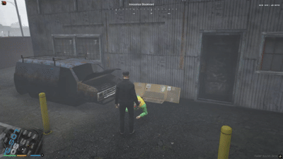

# old_sadClown

A modular Halloween event script built for FiveM servers running the **ESX Framework**.

Sad, slumped clowns appear throughout the city. Players must locate them and interact to offer candy and cheer them up. However, the streets are unpredictable: some clowns may turn hostile, draw a weapon, and demand all your sweets.



---

## Features

- **Dynamic Ped Streaming**: Peds spawn only when players are in range and clean up when far away, ensuring optimal client performance.
- **Interactive Cheer-Up Mechanic**: Players deliver treats via smooth custom animations and receive random configurable loot (cash, black money, items).
- **Robbery Event (Plot Twist)**:
  - Configurable probability for clowns to turn hostile instead of accepting the treat.
  - The clown pulls out a dagger (`WEAPON_DAGGER`), aims at the player, and demands all their candy.
  - Interactive on-screen prompt:
    - **[E]** Surrender all candy; the player raises their hands and the clown flees into the city.
    - **[X]** Refuse and fight; the clown retaliates immediately with melee attacks.
  - Anti-one-shot protection (`SetPedSuffersCriticalHits(ped, false)`).
  - If the player neutralizes the fleeing or hostile clown, they can interact with the body (`[E]`) to reclaim their stolen candy.
  - Strict distance-based cleanup: clowns only despawn once they are far away from the player.
- **Configurable Map Blips**: Optional map markers that automatically update and disappear upon completing each clown.
- **Session Progress Sync**: Per-player tracking prevents repeat completions during the server session.
- **Direct Code**: Clean, production-ready Lua code with zero runtime console bloat.

---

## Dependencies

- **es_extended** (ESX Legacy recommended)

---

## Installation

1. Download or clone this repository into your server's `resources` directory:
```bash
resources/[events]/old_sadClown
```

2. Add the resource start command to your `server.cfg`:
```cfg
ensure old_sadClown
```


3. Make sure the required item (default: `bread` or your custom item like `halloween_candy`) exists in your items database or inventory configuration.
4. Restart your server or run `refresh` and `start old_sadClown` in your server console.

---

## Configuration

All core mechanics, items, coordinates, drop chances, and texts can be adjusted in `config.lua`:

| Parameter | Type | Description |
| --- | --- | --- |
| `Config.RequiredItem` | string | Name of the item required to interact with clowns. |
| `Config.RequiredCount` | number | Amount of items required for a standard cheer-up. |
| `Config.DistanceInteraction` | number | Distance threshold to display interaction prompts. |
| `Config.DistanceSpawn` | number | Radius at which clowns are streamed and spawned. |
| `Config.DistanceDespawn` | number | Radius at which completed/fleeing clowns are removed. |
| `Config.PedModel` | hash/string | Ped model used for the clown entities. |
| `Config.RobberyChance` | number | Percentage chance (0-100) for a clown to initiate a robbery. |
| `Config.RobberyAimTime` | number | Duration (ms) the clown holds the player at knife point. |
| `Config.WeaponModel` | hash/string | Weapon given to the clown during a robbery. |
| `Config.EnableBlips` | boolean | Toggle map blips on or off. |
| `Config.Rewards` | table | Weighted reward table with item, cash, or black money pools. |
| `Config.Clowns` | table | List of clown spawn locations formatted as `vector4(x, y, z, heading)`. |

---
